Cofathon 2026(크래프톤 FDE 트랙) 최우수 수상. 지금은 위메이드엑스알에서 AI 엔지니어 인턴으로 일합니다. 제안 PM으로 참여한 제안의 누적 매출 17억, 그때처럼 쓰는 사람의 기준을 먼저 받아 와 AI가 그 기준대로 움직이게 만들고 결과를 잽니다.

작품 모음 [ljhljh0703-cmd.github.io](https://ljhljh0703-cmd.github.io/) · 메일 [ljhljh0703@gmail.com](mailto:ljhljh0703@gmail.com)

직무별 대표 작업: [플랫폼 · 서버](https://ljhljh0703-cmd.github.io/platform/) · [AI 엔지니어](https://ljhljh0703-cmd.github.io/ai/) · [현장 AI 배치](https://ljhljh0703-cmd.github.io/fde/) · [게임 개발](https://ljhljh0703-cmd.github.io/game/) · [AI 에이전트](https://ljhljh0703-cmd.github.io/agent/) · [AI 스토리텔링](https://ljhljh0703-cmd.github.io/story/) · [전체 목록](https://ljhljh0703-cmd.github.io/all/)

### 대표 프로젝트

<table>
<tr>
<td width="50%"> <a href="https://github.com/ljhljh0703-cmd/game-ops-platform">코드</a> · Java · Spring Boot · PostgreSQL</td>
<td width="50%"> <a href="https://github.com/ljhljh0703-cmd/AI-Book-Curation">코드</a> · 4인 팀 팀장</td>
</tr>
<tr>
<td width="50%"> <a href="https://ljhljh0703-cmd.github.io/jelly-panic/">바로 플레이</a> · <a href="https://github.com/ljhljh0703-cmd/jelly-panic">코드</a></td>
<td width="50%"> <a href="https://github.com/ljhljh0703-cmd/StarLink">코드</a> · Swift · Python</td>
</tr>
<tr>
<td width="50%"> <a href="https://github.com/ljhljh0703-cmd/Medical-Chatbot/tree/juhyeong">코드</a> · 4인 팀 팀장</td>
<td width="50%"> <a href="https://penelope-ontology.vercel.app">라이브 데모</a> · <a href="https://github.com/ljhljh0703-cmd/penelope-ontology">코드</a> · OpenAI Build Week 제출</td>
</tr>
</table>

저장소마다 README 맨 위에 실행 방법, 시험 명령, 내가 정한 것 · AI가 짠 것 · 내가 확인한 것을 적어 두었습니다.

### 함께 보기

- [Cofathon 2026](https://ljhljh0703-cmd.github.io/cofathon/): 비개발자 현업 담당자를 4시간 안에 인터뷰하고, 그 사람의 판단 기준대로 움직이는 연습 도구를 만들어 최우수 수상
- [회귀자는 탑을 오른다](https://ljhljh0703-cmd.github.io/hwigi-tower-portfolio/Docs/Portfolio/hwigi-tower-steam-portfolio.html): 강화학습으로 전투 규칙의 빈틈을 찾아 동료의 행동 규칙으로 옮긴 Unity 게임
- [Agent Forge](https://ljhljh0703-cmd.github.io/agent-forge/portfolio.html): 아이디어 한 줄로 기획서·그림·게임·검사가 차례로 도는 파이프라인
- [Learning Atlas](https://ljhljh0703-cmd.github.io/learning-atlas/): 매주 공개하는 공부 기록
- [Vibe Design Studio](https://ljhljh0703-cmd.github.io/VDS/case.html): 바이브 코더용 디자인 시스템 모음
